# NXP Application Code Hub

## RD RW612 BGA Wi-Fi Softphone — Embedded VoIP Demo: Fully Functional SIP Softphone with Voice Calling and Text Messaging

This project is a SIP softphone demo running on the **NXP RW612** (RD-RW612-BGA evaluation board). It demonstrates a fully functional VoIP client built on top of the open-source [Baresip](https://github.com/baresip/baresip) SIP stack, ported to run on FreeRTOS with the NXP MCUXpresso SDK.

[
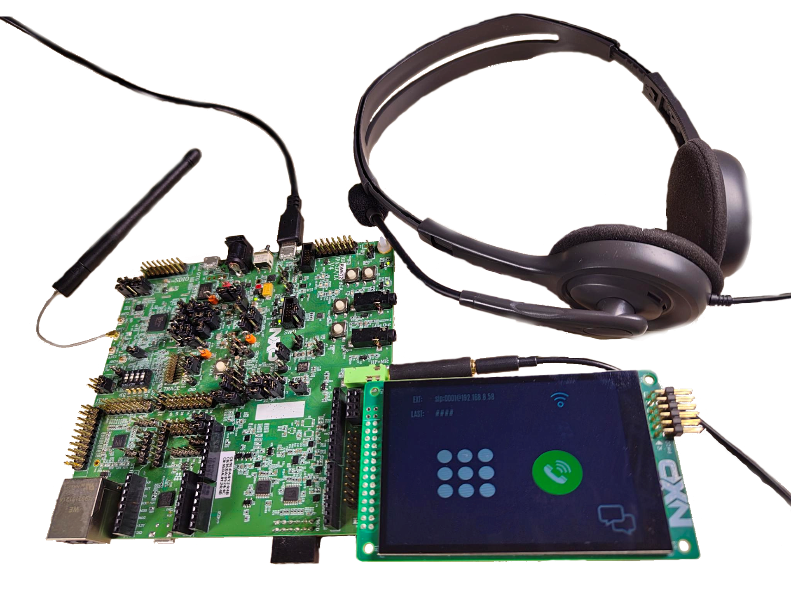
](./images/Softphone_RD_Demo.png)

### Key features

- **SIP registration** over TLS (SIPS) or plain UDP
- **Incoming and outgoing audio calls** using G.711 (µ-law/a-law) or Opus codecs
- **Secure transport** — TLS 1.3 via MbedTLS 3.x for both SIP signaling (port 5061) and media (SRTP)
- **Mutual TLS (mTLS)** — optional client certificate verification, controlled at compile time via `MTLS_VERIFY_CLIENT`
- **Wi-Fi connectivity** managed by the WPL (Wi-Fi Provisioning Layer); the board can operate as a Wi-Fi client or as an access point for initial provisioning
- **UART based command line console** — Full serial shell for all Wi-Fi and SIP operations
- **Graphical User Interface** — An LVGL-based touch-screen UI runs in parallel as a dedicated FreeRTOS task

#### Boards: RD-RW612-BGA
#### Categories: Wireless Connectivity, Graphics, Voice
#### Peripherals: DISPLAY, FLASH, Wi-Fi
#### Toolchains: GCC, VS Code

## Table of Contents
1. [Software](#step1)
2. [Hardware](#step2)
3. [Setup](#step3)
4. [Results](#step4)
5. [FAQs](#step5)
6. [Support](#step6)
7. [Release Notes](#step7)

## 1. Software

- Visual Studio Code
- MCUXpresso for VSC v26.03 or newer
- SDK 26.3.0 for RD-RW612BGA or FRDM-RW612
- Linphone PC application. Download [here](https://www.linphone.org/en/download/)
- Serial terminal (Teraterm, Putty, or similar)

## 2. Hardware

- RW61X-EVK (RD-RW612-BGA) Rev. V4
- LCD-PAR-S035, 3.5” 480x320 IPS TFT LCD Module
- 1 AUX headset
- 3.5mm OMTP to CTIA Headphone Adapter
- 1 micro USB cable

The RW612-EVK board requires the following hardware rework to support the LCD-PAR-S035:

Short jumpers JP3, JP44, and JP50.
Install wire bridges on R624, R625, R626, R627, R629, R630, R631, R616, R662, R663, R664, and R665.
Set switch SW1 on the LCD-PAR-S035 to position 011 (IM[2:0]). Note: the leftmost switch is IM[0] and the rightmost is IM[2].

[
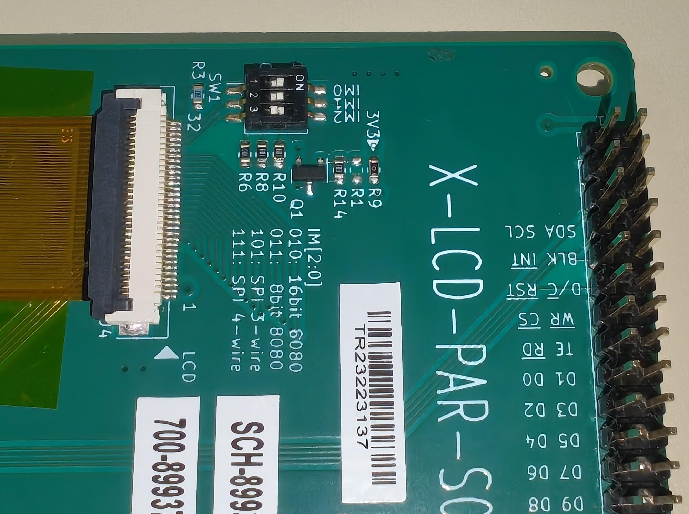
](./images/LCD-PAR-S035_config.png)

Connect the LCD-PAR-S035 to header J23, aligning pin J23-1 with LCD pin J1-1.

[
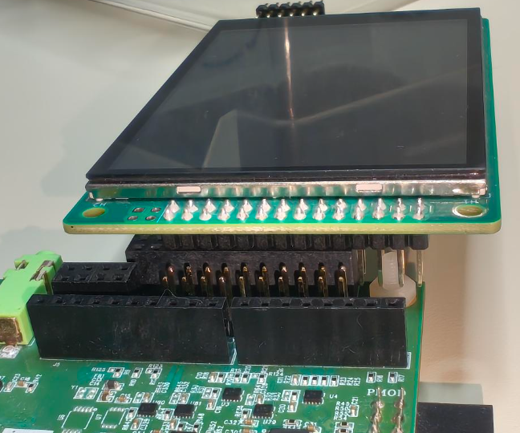
](./images/LCD-PAR-S035_connection.png)

Connect the 3.5mm OMTP-to-CTIA Headphone Adapter to the HP+Mic connector of the EVK board, then connect a standard CTIA headset to it.

[
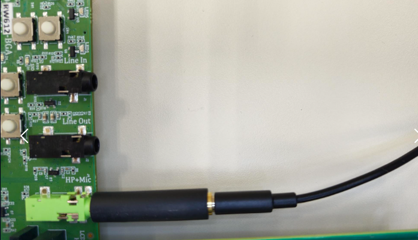
](./images/rdrw612evk_jack.png)

## 3. Setup

### 3.1 Prepare before importing code

1. [Install VS Code](https://www.nxp.com/design/design-center/training/TIP-GETTING-STARTED-WITH-MCUXPRESSO-FOR-VS-CODE).
2. [Install the MCUXpresso for VS Code extension](https://www.nxp.com/design/design-center/training/TIP-GETTING-STARTED-WITH-MCUXPRESSO-FOR-VS-CODE).

### 3.2 Import example from Application Code Hub

1. Open the MCUXpresso extension in VS Code.
2. In the Quick Start panel, click **Application Code Hub**.
3. In the search field, type:
   `"RD RW612 BGA Wi-Fi Softphone"`
4. Select the example.
5. Update the project name and choose the directory where it will be saved.
6. Click **Import Project** and wait a few minutes.
7. If a window appears at the top of VS Code, select the projects to import and continue.
8. The demo projects should now appear in the **Projects panel**.

### 3.3 Flash your EVK board

1. Connect the EVK board to your computer using a micro-USB cable.
2. Open the MCUXpresso extension in VS Code.
3. Select the project:
   `dm-rd-rw612-bga-softphone`
4. Right-click the project and select **Pristine Build**, then wait about one minute.
5. Click **Run** (play icon).
6. Wait a few seconds.
7. Click **Stop** if needed.

### 3.4 Open Serial Monitor with these parameters

- 115200 bps
- 8 data bits
- 1 stop bit
- No parity
- No flow control

### 3.5 Connect the board to a Wi-Fi Network

The first screen of the demo guides you through connecting your board to a Wi-Fi network.

[
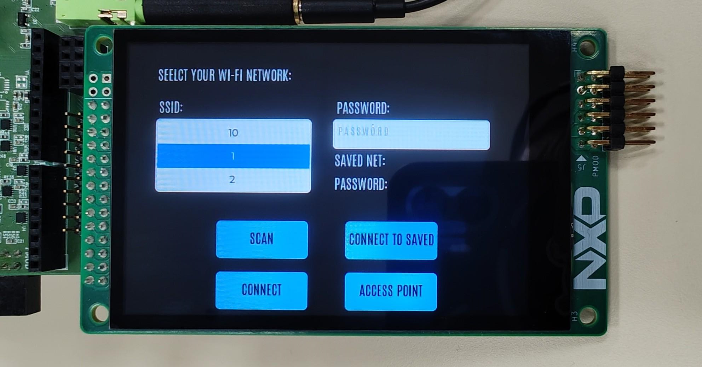
](./images/softphone_screen_wifi.png)

Press the **SCAN** button to perform a Wi-Fi scan. Once the scan is completed the results will be listed in the **SSID** drop-down list.

Once you select a network from the **SSID** list then you can write the password in the **PASSWORD** text box and press **CONNECT**.

Once you successfully connect to a network, the SSID and Password get stored in the board's NVM so it can be easily connected again with the **CONNECT TO SAVED** button.

If you don't have a Wi-Fi network to connect to, you can use the **ACCESS POINT** button to start a new Wi-Fi network with SSID **rw612_softphone** and password: **12345678**.

Once the board is connected, the home screen is displayed. It contains three buttons: one opens the **dialpad screen**, another **starts a call** with the last number that called the board, and the third opens the **text messages screen**. At the top of the screen, the SIP URL is shown — this address can be used in a VoIP application such as Linphone to call the board.

[
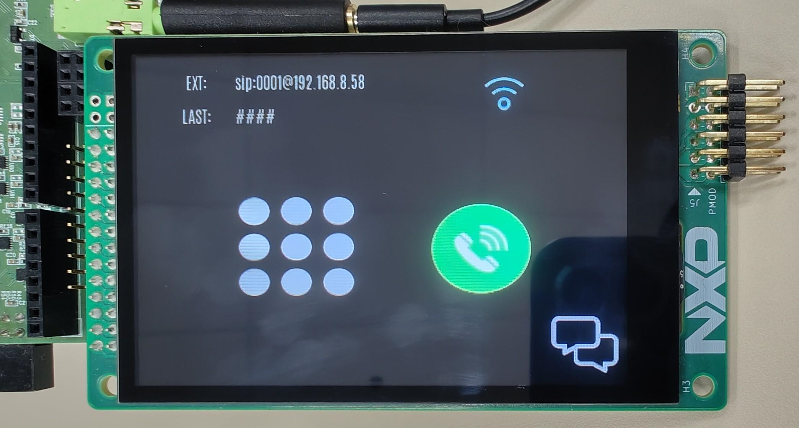
](./images/softphone_screen_call.png)

## 4. Results

### 4.1 Call the EVK board with LinPhone

Connect your PC to the same Wi-Fi network as the EVK board.

[
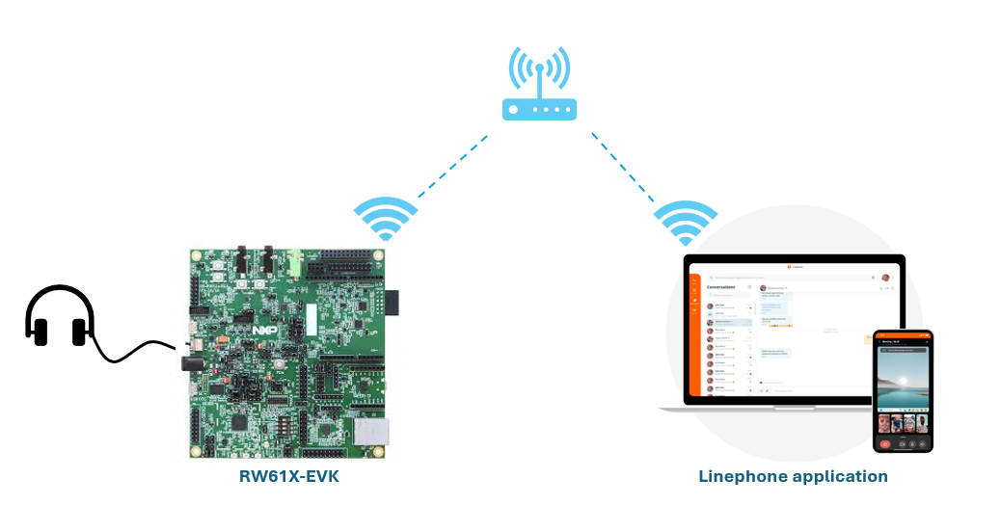
](./images/rdrw612evk_softphone_connection.png)

Once connected to the same network, open the Linphone application and enter the SIP URL displayed on your EVK's screen in the search bar.

[
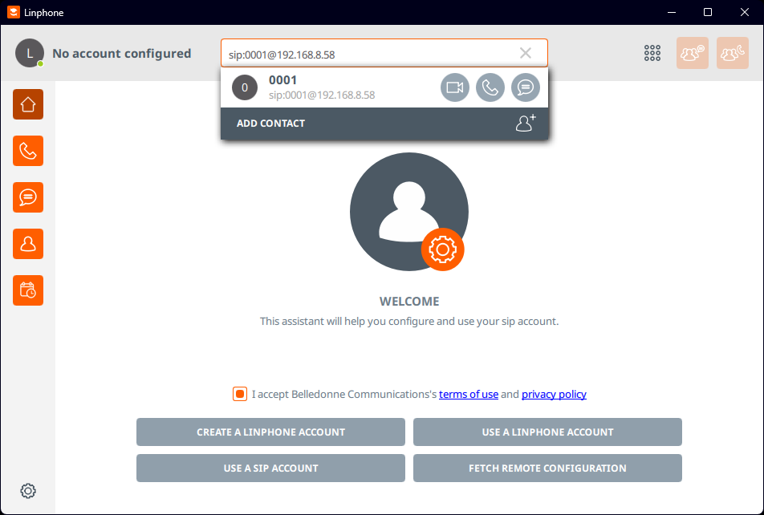
](./images/linphone_start.png)

Now press the **dial** button.

[
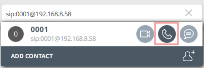
](./images/Linphone_dial.png)

An incoming call will appear on the EVK's screen. You can use the green button to answer the incoming call and start the audio stream.

[
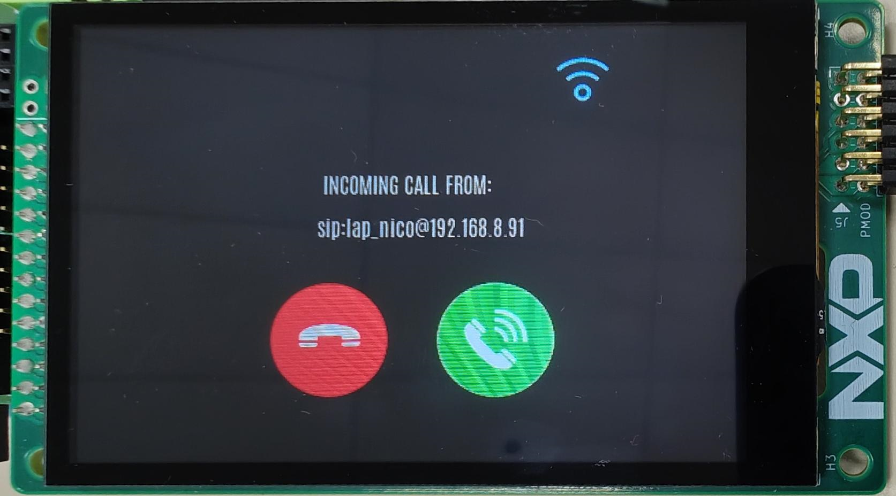
](./images/softphone_screen_incomming_call.png)

Last, you can end the call.

[
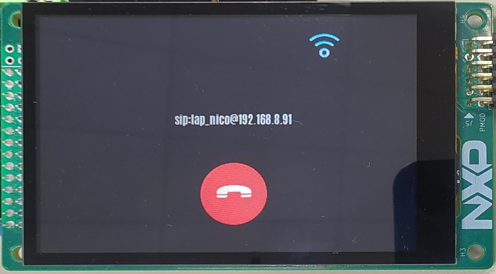
](./images/softphone_screen_incomming_end_call.png)

### 4.2 Send and receive instant text messages between the EVK and your PC with LinPhone

Connect your PC to the same Wi-Fi network as the EVK board.

[

](./images/rdrw612evk_softphone_connection.png)

Once connected to the same network, open the Linphone application and enter the SIP URL displayed on your EVK's screen in the search bar.

[

](./images/linphone_start.png)

Now press the **messages** button.

[
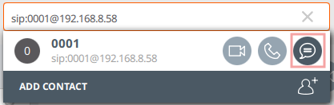
](./images/Linphone_message.png)

You can use this screen to exchange instant text messages between the EVK and your PC.

[
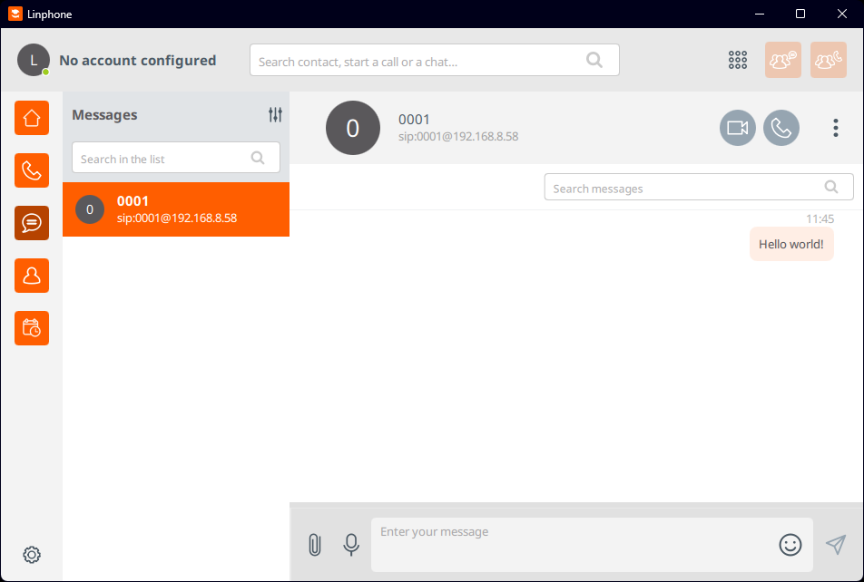
](./images/linphone_messages_panel.png)

Messages will automatically appear in the EVK's display UI. You can use this screen to reply.

[
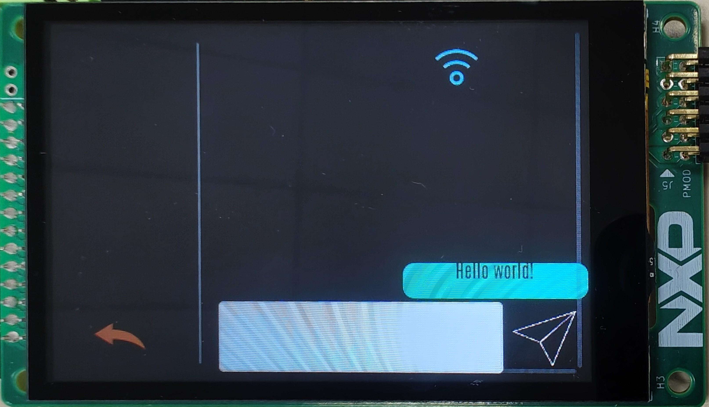
](./images/softphone_screen_messages.png)

## 5. Support

#### Project Metadata

<!----- Boards ----->

<!----- Categories ----->

<!----- Peripherals ----->

<!----- Toolchains ----->

Questions regarding the content/correctness of this example can be entered as Issues within this GitHub repository.

>**Note**: For more general technical questions regarding NXP Microcontrollers and the difference in expected functionality, enter your questions on the [NXP Community Forum](https://community.nxp.com/)

## 6. Release Notes
| Version | Description / Update                           | Date                        |
|:-------:|------------------------------------------------|----------------------------:|
| 1.0     | Initial release on Application Code Hub        | October 6th 2026 |
